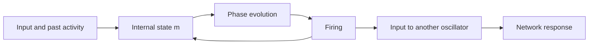
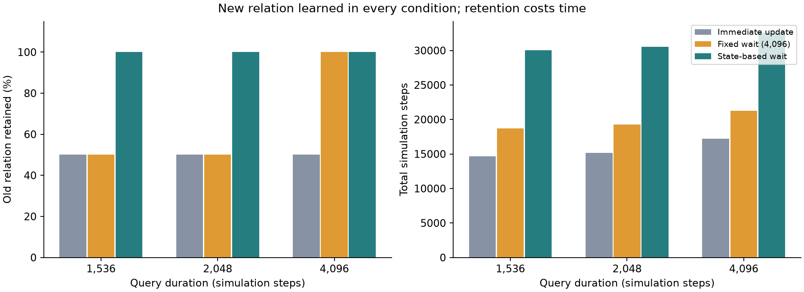

# Oscillator Mind

### Memory-Dependent Oscillator Networks

**How does memory shape dynamics, computation, and learning in networks of oscillators?**

Oscillator Mind is a research program by Keisuke Ohtani that starts with individual oscillators whose internal memory changes their motion, then asks what happens when these units are connected. Can experience retained in a dynamical state change firing, influence another unit, support repeated computation, and be updated by later experience?

The work proceeds from **single-unit properties to connected systems**. Learning readiness is one finding along that path. This public repository introduces the broader program and provides **OTB21 as the first fully bundled reproducible study**.

Read the illustrated research journal at **[basin-mv.com](https://basin-mv.com/)** ([English](https://basin-mv.com/en/)), including the [OTB21 study article](https://basin-mv.com/en/journal/learning-readiness/). [Repository history](docs/PUBLISH.md).

## The starting point: memory changes motion

In the T7 implementation used here, a unit has a history-dependent state `m`, a phase `phi`, and a refractory counter. Its proposed phase increment is `omega + kappa*m`. Inputs and firing change `m`, which changes subsequent motion and firing. Connecting units allows those history-dependent events to drive other units.



This loop makes retained history part of the system's dynamics. It also creates difficulties: a state useful for retaining history may be unsuitable for the next computation. Later OTB experiments add a bistable companion memory and explicit learning states; they do not all use a bare T7 unit alone. [Single-unit model and component roles](docs/INDIVIDUAL_DYNAMICS.md).

## Four connected research questions

| Direction | Question | Current evidence and boundary |
|---|---|---|
| **Individual dynamics** | How do memory, phase, firing and input response interact? | The coupled state updates are available in the bundled model. This release explains that implementation; it does not reproduce the full historical single-unit analysis. |
| **Network computation** | How can one unit's history-dependent response become usable input to another? | Earlier E/OM studies investigated connected memory, processing and readout units. E7-D reports preparation selection through a firing circuit; its report is included, its full reproduction package is not yet included. |
| **Continual computation & learning** | Can the system keep computing and update experience without corrupting other memories? | E7-D addresses repeated computation. OTB15 explores error-driven memory updates. **OTB21 is runnable here:** a state-based waiting condition protects old relations during learning, at additional time cost. |
| **Experience sharing** | Can connected systems jointly use experiences stored by different owners? | OTB22 reports a minimal three-module simulation. Shared firing enables joint use while connected; recipient learning, contradiction handling and real distributed operation remain open. |

Read the [research map and evidence levels](docs/RESEARCH_MAP.md). The four directions organize the program; they are not four completed capabilities of a single integrated AI.

## Reproducible studies

### OTB21 — Learning readiness and memory interference

A previous query leaves an eligibility trace. A later teaching error can then affect an unrelated memory. In this small binary task, waiting for a retention condition **before the next query** permits the changed relation to be learned while preserving the unchanged relation.



| Query duration (steps) | Immediate update: old relation retained | Fixed 4,096-step wait | State-based wait |
|---:|---:|---:|---:|
| 1,536 | 64/128 | 64/128 | 128/128 |
| 2,048 | 64/128 | 64/128 | 128/128 |
| 4,096 | 64/128 | 128/128 | 128/128 |

The new relation was learned in **128/128 conditions in every group**. Each group reuses eight learned memories, four phase draws and four context transitions; it is not 128 independent worlds. For the shortest query, mean total time is **14,632 / 18,728 / 30,040.25 steps**. A better tuned, longer fixed wait could explain the advantage; matched-time superiority has not been established.

[Study overview](docs/studies/OTB21.md) · [Method](docs/METHOD.md) · [Original report](results/otb21_readiness_history_validation/REPORT.md)

### Run the public study

Python 3.12, CPU only. No API key, GPU or private repository access is needed.

```bash
git clone https://github.com/type37c/oscillator-mind.git oscillator-mind
cd oscillator-mind
python -m venv .venv
source .venv/bin/activate
pip install -r requirements.txt
python scripts/plot_results.py
python experiments/otb21_readiness_history_validation/independent_audit.py
```

Fresh acquisition from the bundled learned memory states:

```bash
python experiments/otb21_readiness_history_validation/run.py --name reproduction_01
```

A new name is required on each run. The first run compiles Numba kernels. The saved-data audit targets the preserved acquisition; it is not an audit of arbitrary new output directories. [Reproduction details](docs/REPRODUCTION.md).

**Verification status:** the 1,152-condition acquisition was rerun locally and its record dictionaries matched the preserved results exactly; numerical state differences are recorded in [release validation](docs/RELEASE_VALIDATION.json). The saved-data audit passes locally. The initial GitHub Actions run failed before any test step started, so hosted CI has **not** passed. [CI status and diagnosis](docs/CI_STATUS.md).

## Scope and open questions

The present evidence comes from limited numerical systems with designed tasks and connections. Parts of preparation, routing, teaching-error computation and readout remain external. Different studies use different components, including conventional readouts or LIF relays where specified. General intelligence, automatic concept discovery, oscillator-specific superiority and hardware efficiency are not established.

The next questions are concrete: which state information is necessary for computation; when firing preserves enough of it; how to update a target memory without affecting others; and how joint use of experience can handle conflicting evidence. See [collaboration topics](CONTRIBUTING.md).

## Reading and reuse

- [日本語の研究概要](docs/README.ja.md)
- [Research map](docs/RESEARCH_MAP.md) and [single-unit explanation](docs/INDIVIDUAL_DYNAMICS.md)
- [Evidence index](docs/evidence/README.md): distinguishes included reports from runnable studies
- [Provenance and AI assistance](docs/PROVENANCE.md)

This is an independent research project; no institutional endorsement is implied. No open-source license has yet been selected by the author. Public visibility alone does not grant a general redistribution or modification license.
