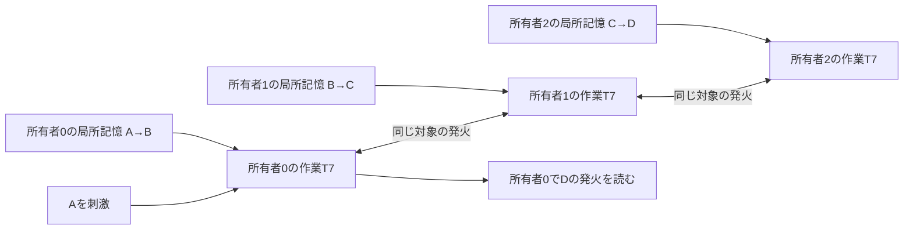

# OTB22：振動子ネットワークは経験を共有する土台になるか

2026-11-05。人工的な一段経験を持つ3モジュールの数値機構試験。
本取得・別実装による監査を完了。

**判定：他者が別々に保持した経験を、振動子の発火結合を通じて接続中に共同利用する最小機構は成立した。**
受け手だけでは出ない支持応答が共有時に16/16条件で出て、必要な局所記憶や共有線を切ると消えた。
受け手の初期状態を固定して提供者の経験だけを変えると、応答も変わった。
ただし、相反する経験の自動検知・保留、人間の語りの理解、受け手への経験の学習、規模拡大や通常方式への優位は未実証。
以下の16条件は8位相×2座標表示であり、16種類の独立した世界ではない。

## 何を「共有」として試したか

各モジュールは、独立したT7＋相方のP/K記憶と、4個の作業T7を持つ。
一つのモジュールがA→B、別のモジュールがB→C、もう一つがC→Dを経験する。
他者が持つ経験は、受信者の記憶へコピーしない。各記憶はその所有者内の結合だけを変える。
所有者間の共有線には、同じ対象を表す作業T7の前stepの発火だけを通す。

各作業群はA/B/C/Dの4対象を持つ。図の一本の共有線は、同一対象ごとの双方向線をまとめた表記。
対象の同一性、所有者ID、文脈の周波数、接続相手は与えたもので、意味や共有許諾を自動発見した結果ではない。
Pythonで途中の答えを解読して次の問い合わせを選ぶ処理や、正解の経路探索を実行器へ渡す処理は使わない。

正解は「与えた一段の証言を、所有者間の共有線とともに接続したグラフに支持経路があるか」。
現実の因果関係や、他人の体験が別の人にも当てはまることを示す課題ではない。
下側の支持伝播だけを測り、無発火は保留とする。不成立の理解を獲得したとは数えない。

学習はOTB8/9の20,000 stepの教師駆動によるP/K書込みであり、OTB15のe/s誤差学習ではない。
共有中は記憶への新しい教師入力を与えず、共有線や作業T7から記憶への帰還もない。
したがって、同じ経過時間で局所記憶が一致することは構造上予測される。保持確認は非破壊読出しの検査であり、共有後の新しい学習による干渉を防げたという成果とは分ける。

## 最初の常時接続案は通過しなかった

最初は共有線の利得0.6、問い合わせ16,000 step、刺激前の復元入力1,024 stepを使った。
接続すると答えは出たが、途中の経験を否定した文脈でも答えが出た。必要な他者の記憶伝達を切っても残り、問い合わせ後にも活動が続いた。
この結果を共有成功とは扱わない。保存した元の記憶式との256 stepの照合は、最大絶対差2.23×10⁻¹⁶未満・記憶帯一致だったが、機能基準は満たさなかった。

利得を0.3、続いて事前に限定した0.35/0.40へ変更するpilotを別々に保存した。
元の全通過条件は、正しい戻り応答、負例での誤支持なし、必要な記憶・刺激・共有の切断で応答消失、連続文脈切替、尾部の対象発火ゼロ、記憶帯保持だった。

| 共有線の利得 | 支持経路があるときの戻り応答 | 経路を切った文脈への誤支持 | 必要な局所記憶を切っても戻り応答 | 尾部の戻り応答 |
|---:|---:|---:|---:|---:|
| 0.60 | 2/2 | 2/2 | 3/6 | 2/2 |
| 0.30 | 1/2 | 0/2 | 0/6 | 0/2 |
| 0.35 | 2/2 | 0/2 | 0/6 | 1/2 |
| 0.40 | 2/2 | 0/2 | 0/6 | 2/2 |

2は同じ論理的な鎖に対する2位相条件、6は2位相×3局所記憶の切断であり、独立した意味課題数ではない。
0.35/0.40の文脈0→1→0は両位相で支持→保留→支持だったが、尾部の条件を満たさなかった。
4利得とも、元の選択規則では不通過である。

元の尾部は記憶・作業状態・フィルタを継承する一方、参照波の時刻を0へ戻していた。
したがって、入力位相まで完全に連続した自律停止試験とは区別する。この点を後から変更して、元pilotを合格へ読み替えていない。

## 外部の時間制御で共有を区切る案を追加した

利得0.35を固定し、参照波の時刻を継承するAPIを追加した。元設定での30保存境界・発火数・初回発火・刺激前発火が完全一致することを確認した。

旧pilotの2位相×2読出し終端から、共有線の開閉と既存復元入力の有無を2×2で比較した。
1,024 step後に共有線を開き、刺激も復元入力も与えず8,000 step進めた。

| 1,024 stepの処理 | 再接続後にいずれかの作業T7が発火した境界 | 再接続後の対象発火 |
|---|---:|---:|
| 共有線を開いたまま、復元なし | 1/4 | 1/4 |
| 共有線を閉じるだけ | 1/4 | 1/4 |
| 共有線を開いたまま、復元あり | 0/4 | 0/4 |
| 共有線を閉じ、復元あり | 0/4 | 0/4 |

このpilotで効いたのは復元入力であり、共有線を閉じることの追加効果は示していない。
復元中もT7の式で状態を進め、位相・内部状態を代入して初期化したわけではない。
同じ処理後から分岐した次の文脈1の問い合わせには全方式で誤支持がなかったが、文脈1は支持経路がないため、これだけで正しい支持の再開を示したとはしない。
無刺激の再接続検査と次文脈の検査は別コピー枝である。

## 本取得

### 条件

利得0.35、問い合わせ16,000 step、刺激前復元1,024 step、引継ぎ1,024 step、無刺激検査8,000 stepを取得前に固定した。
未使用の8初期位相を、元の対象座標と固定した改名座標の2表示で試した。位相ごとの記憶offsetは所有者別、作業位相は所有者・対象別に異なる。
同一の鎖と、その提供者の経験変更・対立証言の3系列で48系、全条件・対照・診断を合わせて1,472区間を保存した。
取得時間は306.82秒。このCPU時間を実機性能へ換算しない。

学習・保持は全系列で3入力slot×20,000＋8,000＝68,000 step。
第3slotで、通常系列は無入力、提供者変更系列はowner1だけがB↛Cを再経験、対立系列はowner2がB↛Cを追加経験する。
作業状態・フィルタもこの期間を進め、学習後に初期状態を代入し直していない。
受け手owner0の問い合わせ開始時の記憶・作業状態・フィルタは、対応する3系列でbit単位に一致した（32組の対照）。

### 共有と局所経験への依存

| 条件 | 受け手owner0のDに支持応答が出た条件数 |
|---|---:|
| 3者の経験が鎖を作り、共有する | 16/16 |
| 同じ状態で共有しない | 0/16 |
| 問い合わせ刺激を与えない | 0/16 |
| 必要な局所記憶から作業群への伝達を1者ずつ切る | 0/48 |
| owner0↔1、またはowner1↔2の共有接続を遮断する | 0/32 |
| 全局所記憶からの伝達を切る | 0/16 |
| B↛Cを経験した別文脈を問い合わせる | 0/16 |
| 提供者owner1だけが、同じ文脈でB↛Cを再経験する | 0/16 |

支持時の初回応答は刺激後4,051〜6,791 step、平均5,175.25 step。
単に他者が存在するだけの発火ではなく、その局所経験と共有線が応答に必要だったことを、この条件内で確認した。
非支持の無発火は保留であり、「Dへは到達できない」という否定を振動子が理解したとは扱わない。
局所記憶の切断は記憶の削除ではなく、同じ記憶を保ったまま作業群への結合を無効にする対照である。
所有者間の共有接続の遮断は、その区間の4対象・両方向、合計8有向線を一括して切る。単一の有向線を切った試験ではない。

### 連続利用と停止

文脈0→1→0を、全記憶・作業・フィルタと参照時刻を引き継いで問い合わせた。
各読出し後に同じ1,024 stepを置き、共有線の開閉と復元入力を比較した。

| 引継ぎ方式 | 次の文脈1への誤支持 | 再び文脈0へ戻したときの支持 | 無刺激再接続後のいずれかの作業T7の発火 |
|---|---:|---:|---:|
| 共有線を開いたまま、復元なし | 0/16 | 16/16 | 0/48 |
| 共有線を開いたまま、復元あり | 0/16 | 16/16 | 0/48 |
| 共有線を閉じ、復元あり | 0/16 | 16/16 | 0/48 |

48は16条件×3つの読出し後の境界。引継ぎ中にも全方式で作業発火はなかった。
各無刺激区間は引継ぎ後からの比較枝であり、その終端は次の問い合わせへ戻していない。
通常の3読出しと3引継ぎを続ける本体は51,072 stepで、別枝の検査時間は含まない。

**本取得では復元なしでも停止したため、追加復元や共有線閉鎖の優位・必要性を示していない。**
旧停止pilotでは復元の有無に差があった。本取得では位相に加え、学習期間中からの作業状態継承など履歴も異なり、この差の原因は切り分けていない。
すべての履歴で安定する保証や、自律的に問い合わせを開始・停止する能力を主張しない。
各問い合わせ前の1,024 stepの復元、文脈の指定、刺激の投入時刻は全方式で外部から与えている。

### 保持と相反する経験

同時間の共有有無96組で、全局所記憶の終端状態がbit単位で一致した。
全1,472区間で取得器の毎step帯検査は保持を記録した。各所有者への直接問い合わせは、共有前と最初の共有読出し＋閉鎖・復元後に比較した。
両時点それぞれ、支持される局所関係224/224で応答、支持されない局所関係64件では応答0だった。
これは新しい経験を書かない読出しの保持確認であり、後続の学習干渉を解決した結果ではない。

対立系列では、owner1のB→Cとowner2のB↛Cを、それぞれのP/Kへ別々に残せた。
共有前・後ともowner1の直接問い合わせは16/16支持、owner2は0/16支持だった。
しかし、ネットワーク全体への問い合わせは16/16でDを支持した。
**対立証言の共存はできても、その対立を理由に自動で保留する機能はない。**
今回の正の支持伝播には、否定証言で他者の正証言を打ち消す機構がなく、所有者の違いも与えた記憶アドレスである。
外部の採点器が対立箇所を指摘できることを、振動子自身の矛盾検知や出典説明と呼ばない。

### 検証

取得前ソース・設定と保存snapshotのSHA256はすべて一致した。
取得器をimportしない[別実装の監査](main/main_20261105/audit_independent.json)で、全1,472件の条件・集計・親境界・参照時刻と、発火からの共有入力積算を照合した。
直接観測からP/Kの正負・未観測を再構成し、採点専用の所有者×対象グラフで支持経路を独立計算した。
source刺激切断や無刺激区間は、構造上の経路があっても応答しないことを期待するため、通常の支持失敗率へ混ぜていない。

3系列それぞれ1条件の68,000 stepの学習・保持を元のOTB2の式で再生し、保存境界に誤差0で一致した。
全48系の学習中の作業状態も別計算で一致した。
保存5軌跡、計64,000 stepでは、元の記憶式と別実装の作業・フィルタ計算で全発火が一致し、作業状態の最大絶対差は1.12×10⁻¹³未満だった。
全区間の記憶終端と取得器の帯保持フラグを確認し、毎stepの振幅を直接再照合した範囲はこの5軌跡である。
元の記憶関数を共有した式の照合であり、独立した物理実験ではない。
監査は同一プロジェクト内の別担当・別実装による検査で、第三者機関の認証ではない。

## 費用と実サービスとの差

3所有者×2文脈×12有向対象対×P/Kで、記憶は144組のT7＋相方、720実数状態。
作業T7は12個で48状態、フィルタは72複素状態。float64/complex128の動的な主配列は合計7,296 byte。
ログ、入力、配線、モード比較のコピー、一時配列、外部制御の費用は別である。同一対象を結ぶowner0↔1↔2の共有線は16有向線。

通常の数値表とグラフ探索も同じ課題を扱える。ソフトウェアのstepや状態量から、実機の低消費電力や高速性を主張しない。
今回の共有線は同一プロセス内の数値結合であり、端末間ネットワーク、遅延・パケット損失、位置情報、共有許諾・撤回の実装ではない。

人間の生の経験へ進むには、語りを状態へ符号化すること、異なる人の状況を対応づけること、条件と出典を残すこと、相反する証言を表示・保留することが必要になる。
この試験は、そのうち「局所の記憶をコピーせず、接続中に共同利用する運動が成立するか」を切り出したものである。

したがって、現段階で提案できる用途は、構造化された経験を持つ参加者をつなぐ共同読出しの研究用部品である。
経験共有サービス全体の土台に採用する判断には、人数・経路・通信遅延を増やした試験、対立と出典の取扱い、同じ条件の通常の経験グラフとの費用比較が必要になる。
今回の結果は、その検証へ進む根拠にはなるが、サービスや振動子方式の優位性を証明しない。

## 保存資料

- [設計とpilotの選択経緯](../../experiments/otb22_shared_experience_network/DESIGN.md)
- [共有の理論上の定義](../../experiments/otb22_shared_experience_network/THEORY.md)
- [pilotの記述集計](pilot_analysis.json)
- [停止制御の2×2集計](pilot/session035_factorial/summary.json)
- [本取得の設定・全保存データ](main/main_20261105/)
- [本取得の記述集計](main_analysis.json)
- [本取得の独立監査](main/main_20261105/audit_independent.json)
- [再現手順](../../experiments/otb22_shared_experience_network/README.md)

全pilotの失敗とソースsnapshotを保持した。条件・ソースの固定はローカルSHA256であり、外部の事前登録や第三者機関による実証ではない。
この報告とanalyze.pyは取得後の記述分析であり、取得前固定の範囲とは分ける。
