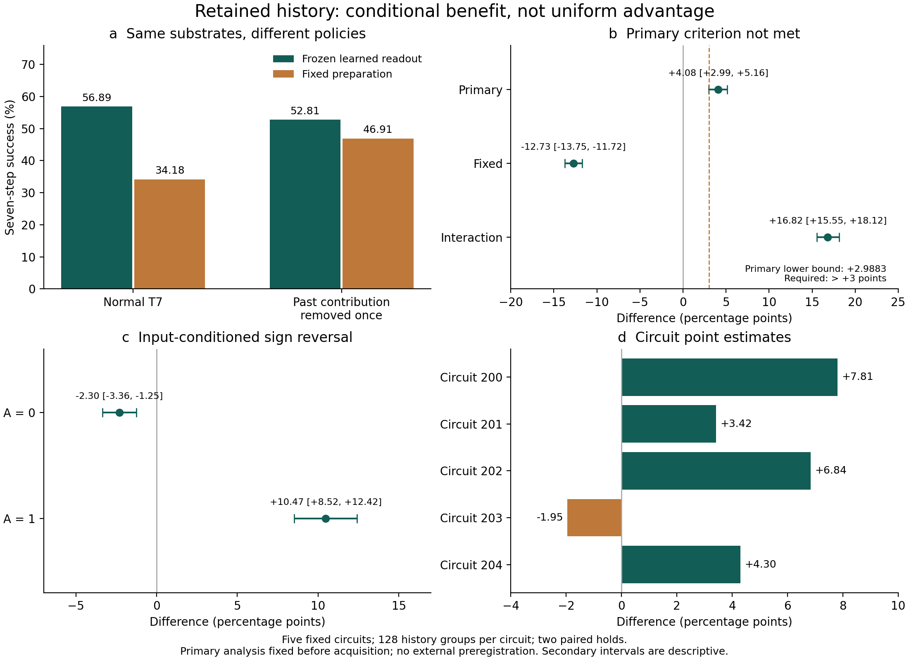
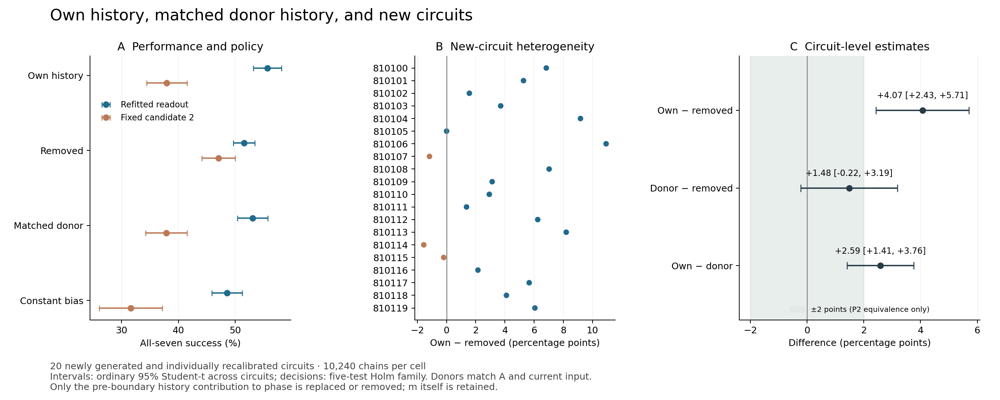

# From Having Memory to Using It: A Research Agenda for Memory-Dependent Computation

Working manuscript — 6 November 2026. Position-paper draft, not a submission-ready
manuscript. The literature discussion is based on focused primary-source checks;
the experimental references remain local versioned records.

## Abstract

A system can retain information about its past yet fail to use that information
for its next computation. We propose evaluating memory-dependent computation
through the operations that make retained history usable under specified
observation, action, time and resource constraints. Three barriers organize the
agenda: reading history and selecting a feasible preparation; acquiring a new
relation while retaining old ones; and accessing experience held by another
system. Small oscillator studies illustrate these barriers without establishing
oscillator superiority. In a locally fixed evaluation of twenty newly calibrated
circuits, normal dynamics outperformed removal of a pre-boundary history
contribution and replacement with a matched donor contribution. Content and
compatibility with other state remained incompletely separated. Other studies
achieved acquisition with retention at substantial waiting cost and connected use
of separately held relations without recipient learning or conflict-sensitive
abstention. Adverse relay comparisons and an earlier unmet minimum-effect
criterion constrain the interpretation. We use “management” as a functional
description, compatible with operations embedded in learned dynamics, not a
requirement for a separate controller. The practical contribution is a protocol
for measuring retention, readout disturbance, action availability and update
interference, with explicit costs and conditions that would weaken the agenda.

## 1. The gap between retaining history and using it

What makes an internal record of the past useful? A decoder may distinguish two
histories while the system's available actions cannot turn that distinction into
a successful response. An update may acquire a new relation while destroying an
old one. A useful relation may remain inaccessible because it belongs to another
system. These are different obstacles, even when each is summarized as a failure
of memory.

Memory and its use already have substantial theoretical and architectural
treatment. Dynamical capacity measures assess reconstruction of functions of
input history through a specified readout. Adaptive spiking models use internal
state to carry effects of past firing. Gated recurrent units and selective state
space models regulate what is retained or incorporated, and external-memory
architectures make access operations explicit. [DAMB2012] [ALIF2018] [GRU2014]
[MAMBA2023] [NTM2014] These precedents rule out a simple opposition between
“static weights” and systems that possess memory. Fixed learned parameters do
not imply a stateless runtime, and an adaptive state does not need to be called
a memory register to carry history.

Our position is that evaluations of memory-dependent computation should state
not only what history can be recovered, but also what operations can use it,
under which constraints and with what effects on later use. This is especially
concrete when a substrate's update rule is fixed or difficult to redesign.
Choosing a preparatory input, waiting for a trace to decay, or reading another
module's response can then be an actionable intervention even when learning an
arbitrary new recurrence is not available. This setting motivates the question;
it does not establish an advantage over trainable alternatives.

We call these functions *management operations*: reading, selecting preparation,
controlling when updates proceed, and accessing another system's retained
experience. “Layer” denotes an analytical organization of functions. Those
functions can be distributed, implicit in learned dynamics, or implemented by
an external controller. Their number is not a scale of intelligence, and merely
adding more operations need not improve performance.

Three walls structure the paper. First, retained history may be unreadable or
unusable with the available preparation candidates. Second, learning something
new may corrupt what is retained. Third, a relation held elsewhere may remain
inaccessible, or be usable only while connected. We examine these walls through
small numerical oscillator studies, including unfavorable and unresolved results.
The studies do not combine into one demonstrated agent. Their role is to make
the proposed questions concrete and expose the limits of convenient summaries.

The intended contribution is a research agenda with a portable diagnostic
protocol. Readers should be able to identify a preservation target, specify
allowed observations and actions, separate selection failures from candidate
absence, and report acquisition together with retention and cost. Whether that
organization predicts useful interventions beyond the examples is itself a
claim to test, not a conclusion secured by naming the operations.

## 2. Scope, limits, and conditions that would defeat this position

### 2.1 What the evidence covers

The empirical examples are simulations of particular architectures and tasks.
Some use externally trained readouts, some direct state access by an external
guard, and some supplied object identities and connections. None establishes
general reasoning, autonomous semantic acquisition or hardware efficiency.
Readout accuracy, seven-step computation, joint acquisition and retention, and
support propagation are different endpoints and are not added into a single
capability score.

Generalization must be named. New inputs to five known circuits differ from new
circuits drawn from a specified generator; neither guarantees transfer to a new
task, topology or optimization procedure. Primary decisions, descriptive
secondary comparisons and exploratory observations retain their original status.
Within-project numerical checks are distinguished from external replication.

### 2.2 Claims that can fail

The following are prospective commitments for a research agenda. The examples
do not establish all of them.

| Claim to test in a specified model and task family | Comparison | Consequence of an adequately precise adverse result |
|---|---|---|
| State-dependent management offers a practical benefit | Match total deadlines, training and observation costs against calibrated fixed policies | Withdraw the practical advantage for that family if it disappears under matched budgets |
| The failure decomposition predicts effective interventions | Use a diagnosis to choose between readout and candidate-set changes, then compare prediction against simple accuracy or elapsed-time baselines | Narrow the framework's diagnostic claim if it adds no predictive value |
| A recipient uses another owner's experience | Change provider experience with the recipient held fixed; ablate memory transmission and communication | Withdraw the experience-use interpretation if responses are independent of provider content or explained by supplied answers |
| The protocol contributes beyond one oscillator implementation | Apply it to prespecified alternative substrates and assess reproducible diagnostic distinctions | Limit it to an oscillator-specific organization if it adds nothing beyond existing measures elsewhere |

A nonsignificant comparison alone is not decisive evidence against a claim.
The design must specify a meaningful effect, uncertainty and the range over which
the adverse evidence is informative. Conversely, a failed prediction should not
be rescued by adding a new operation after observing the result. If fair-budget
benefits consistently disappear and the decomposition does not predict effective
interventions, the case for a distinct research agenda weakens.

### 2.3 A positive estimate that did not meet the chosen criterion

The earlier history-contribution evaluation provides a reporting example.
Before acquiring a new input cohort for five known circuits, the analysis required
the lower bound of a paired-group bootstrap interval to exceed three percentage
points. The normal-minus-removal estimate was +4.0820 points, with a 95% interval
of [+2.9883, +5.1563]. The chosen minimum-effect criterion was not met. Rounding
the lower bound upward, adding observations to that sample, or substituting a
favorable secondary result would not preserve the original decision. [HCREPORT]

There is no scientific discontinuity between 2.9883 and three points. The estimate,
uncertainty and decision under a chosen rule answer different questions. The later
twenty-circuit study examined a separate generalization claim and did not change
the earlier decision. Following the rule is reporting discipline, not additional
evidence for a mechanism or for the proposed framework.

## 3. What is stored, what is observable, and who controls it?

A useful description separates the state that carries history from the operation
that accesses it. In one discrete T7 working-unit implementation, the memory
variable m contributes to phase advance:

```text
proposed_phase = phi + omega + kappa*m
fire = (proposed_phase >= 2*pi) and (cd == 0)
m_next = (1-epsilon)*m + drive - beta*fire
phi_next = 0 if fire else proposed_phase modulo (2*pi)
cd_next = R if fire else max(cd-1, 0)
```

This specifies an update order for the working unit, not every model in the
research series. Coupled implementations also track other state, such as prior
spikes. The persistent effect of history on phase is an implementation property,
not a novelty claim over adaptive or history-dependent neuron models. [HCCODE]

Several distinct quantities must not collapse into the word “memory.” The T7
variable m affects ongoing motion. OTB relation memories also use companion
amplitude states. Eligibility and error-related traces participate in subsequent
writing. A readout may maintain another copy, and a controller may store learned
weights. The location, lifetime and role of each should be stated separately.

For this agenda, *retention* means that a specified past distinction remains in
state or subsequent response; *expression* and *transmission* mean that a
corresponding difference appears in an observable output and reaches a receiver.
*Usability* is relative to a task: whether the permitted information and operations
can turn the retained distinction into the required result before the deadline.
It is not a substrate-intrinsic scalar.

Every experiment should therefore distinguish runtime inputs from evaluator-only
information. Labels used to train a selector, counterfactual outcomes used to
diagnose candidate availability, and external guards with privileged state access
have different roles. Their separation lets an external reader assess which
function the substrate performed and which was supplied by its training or control
environment.

## 4. Wall I — Retained history may be unreadable or unusable

Retaining a distinction from the past is not sufficient to make that distinction
useful in a subsequent computation. A receiver must obtain an informative signal,
a readout must preserve what the task requires, and a policy must have an action
that can succeed from the resulting state. We separate these requirements because
their failures imply different interventions. Improving a decoder will not solve
a shortage of feasible actions, while increasing internal memory may not help a
receiver that cannot use its output. The studies below illustrate these distinctions
in particular simulated systems; they do not establish a universal architecture
for intelligence.

### 4.1 Retention, expression, and transmission do not guarantee use

The MC-4X exploration provides a small example of a mismatch between an available
signal and downstream use. It evaluated five circuits on a task distinguishing
both distant and recent input histories. Its main measure, *both*, was the smaller
of the two discrimination accuracies, rather than overall task accuracy. For a
mixed oscillator population, the output oscillator achieved 0.531. An external
classifier using an integration timescale matched to the receiver achieved 0.546;
allowing a longer integration window yielded 0.698. These results motivate asking
which temporal features a receiver can exploit, rather than treating the arrival
of spikes as evidence of successful information use. [MC4X]

The adverse comparisons matter to this interpretation. With longer integration,
a fast population and a control without memory–motion coupling performed
comparably to the mixed population. This exploration therefore did not establish
an advantage for mixed timescales or for the coupling itself. The receiver,
observation window and training procedure are part of the explanation of the
measured outcome. A failure of one readout does not show that the source contains
no information; success with a different readout does not show that the original
receiver can use it.

### 4.2 Reading without damage requires a preservation target

Readout accuracy and readout disturbance are separate quantities. A perturbation
may preserve a memory variable while changing phase, refractoriness, spike timing
or subsequent task performance. Accordingly, a claim of nondestructive reading
must specify both the object to preserve and a tolerance.

In E7-D, the processor P is accompanied by a system that maintains a copy of its
memory and reads that copy through perturbations. The direct readout kick does
not reach P. The relevant claim is therefore that the mechanism avoids directly
kicking the original processor; it is not that every state of the full system
returns to its initial value. Copy fidelity, readout error, latency and subsequent
computation remain separate evaluation targets. [E7D]

This distinction also makes the method portable. A reader applying the framework
to another substrate can compare reading with an equal-duration no-read control,
measure the changes in specified state variables, and then assess the same
downstream task. If a copy is used, its creation and maintenance belong in the
cost and error accounting. Appendix A gives that procedure without assuming that
all systems permit exact state duplication.

### 4.3 Accurate reading does not ensure a successful preparation

E7-D connects readout to a restricted preparation decision. In its fixed-five-
circuit confirmation, using previously unused inputs and four hold conditions,
the 64-unit readout condition achieved 57.8% success on all seven subsequent
computations, compared with 48.5% for the frozen E7 reference. The reported paired
difference was +9.3 percentage points, with a 95% interval of [+8.7, +9.9]. This
was an evaluation of new inputs to known circuits, not inference over a population
of new circuits. Readout weights were learned externally. [E7D] [E7PLAN]

Its failure decomposition is as informative as the success rate. Of 107,520
subsequent decisions under the 64-unit condition, 11,194 failed. At 10,148 of those
failures—90.7% of failures—neither of the two available preparation candidates
could succeed from the reached state. This is a property of the specified
candidate set, task and time limit. It neither describes 90.7% of all states nor
establishes impossibility over all conceivable controls. Counterfactual candidate
outcomes were an evaluation diagnostic, not information supplied to the online
selector. [E7RESULTS]

Larger readouts also did not translate directly into larger task gains: the
reported seven-step difference between the 16- and 64-unit conditions had an
interval containing zero. The lesson is to measure reading, selection and
candidate availability separately. Because different policies reach different
states, their failure compositions should not be interpreted as a same-state
causal decomposition.

### 4.4 History and preparation policy must be evaluated together

The history-contribution studies ask a complementary question: does the retained
history contribution help the computation performed by a particular policy? The
task requires the output to represent A AND B, where A is a retained binary
condition and B varies between computations. Silence is correct for A=0, whereas
for A=1 the required response depends on B. That asymmetry is a task definition,
not an established explanation of the observed effects.

At the first preparation boundary, the removal intervention defines

```text
h_own = m − m_ref
h_own(t+1) = (1 − epsilon) h_own(t)
effective phase contribution = m − h_own
```

The processor's memory m is not reset; subsequent inputs continue to enter it.
Phase, refractory state and other retained states are also preserved at the
intervention boundary. Removing this component is a model-internal counterfactual
that changes effective phase velocity. It is neither removal of every influence
of the past nor a demonstrated physical control operation. [HCPLAN] [WHPLAN]

The exploratory pilot found that normal dynamics performed better than removal
with separately fitted readouts, but worse under fixed preparation. A subsequent
evaluation used five existing circuits and ten frozen pilot-trained readouts on
a new cohort, with 5,120 chains per cell. Its normal-minus-removal difference was
+4.0820 points, with a 95% paired-group bootstrap interval of [+2.9883, +5.1563].
The prespecified criterion required the lower bound to exceed three points and
was not met. Section 2.3 retains that decision. The fixed-policy contrast had the
opposite sign. [HCPILOT] [HCREPORT]

The comparison evaluates substrate–policy combinations under a matched training
budget. It does not identify the best attainable policy for either substrate or
the effect of changing the substrate while keeping one controller fixed. Even so,
the reversal gives a concrete reason to ask how retained history is used, rather
than assigning it an intrinsic positive value.

### 4.5 What generalized beyond the original five circuits?

A separate study tested generalization under the original circuit generator and
calibration procedure. A training-only feasibility pilot used three new circuits;
none entered the main panel. The protocol, code, circuit IDs, streams and analysis
were then fixed locally before acquiring 20 further circuits. Physical weights,
preparation candidates and timing were recalibrated for each circuit. Each
intervention received its own readout fitted with the same feature class and
training budget. The secondary fixed policy always selected the second slot of
that circuit's calibrated pair, so its physical action could vary across circuits.
[WHPLAN] [WHPILOT]

Each circuit contributed 64 evaluation history groups, four rows per group and
two holds. This yielded 10,240 chains per arm–policy cell and 81,920 across four
arms and two policies. The primary inference unit was a circuit, not a chain.
Five prespecified claims, including two equivalence claims, formed one Holm
family. Ordinary 95% Student-t intervals across circuits describe uncertainty;
they are not multiplicity-adjusted decision intervals. Equivalence used TOST with
a prespecified ±2-point margin. The protocol was locally fixed before acquisition,
without external preregistration. [WHPLAN]

| Refitted-readout comparison | Difference, percentage points | Ordinary 95% interval | Prespecified conclusion |
|---|---:|---:|---|
| Normal − removal | +4.0723 | [+2.4333, +5.7113] | Positive difference supported; Holm p=0.0002546 |
| Normal − matched donor | +2.5879 | [+1.4132, +3.7626] | Own-component advantage supported; Holm p=0.0007626 |
| Matched donor − removal | +1.4844 | [−0.2171, +3.1858] | Donor harm and equivalence to removal not established |

Normal dynamics achieved 55.6348% seven-step success, versus 51.5625% after
removal. The difference was positive in 16 circuits, negative in three and zero
in one. Thus a positive average difference extended beyond the original five
circuits under this generator, calibration and training procedure. The evidence
does not establish a uniform circuit-wise advantage or transfer to arbitrary
topologies, tasks or training procedures. [WHDATA]

The new study did not add observations to the previous sample to obtain a passing
three-point result. It tested a distinct zero-based generalization claim using a
different inference unit. The previous minimum-effect decision remains unmet;
the new interval also includes values below three points.

### 4.6 Own history versus a matched foreign contribution

The donor arm addressed an ambiguity in removal: losing performance might reflect
a change in operating point rather than the identity of a history contribution.
It used m − h_own + h_donor in phase evolution, with both auxiliary components
decaying at the prescribed memory rate. Donor histories came from different
history groups within the same circuit, hold, A and current-input condition. Their
boundary components were recomputed using the recipient's exact current input
amplitude. Donor selection did not use outcomes or state proximity; no donor
phase, refractory state or receiver state was transplanted. [WHPLAN]

Normal dynamics outperformed matched donor replacement by +2.5879 points after
the prespecified Holm correction. All 40 circuit–hold cells met the frozen
marginal-distribution diagnostic; donor/own standard-deviation ratios ranged
from 0.9928 to 1.0079. Thus matching marginal scale did not preserve performance.
However, this is not a complete separation of content from operating point or
state compatibility. Own/donor correlations ranged from 0.8952 to 0.9878, and
matching A and the current input preserves substantial shared task structure.
The intervention replaced a component associated with a different individual
history within that matching class; it did not erase all task-relevant content
or perform a statistical residualization. Marginal matching also does not match
the component's joint distribution with retained phase and other state. [WHDATA]

The donor-minus-removal estimate was +1.4844 points. Neither the prespecified
donor-harm claim nor equivalence to removal was supported. Donor–removal
equivalence had Holm-adjusted p=0.8002; donor–normal equivalence also failed
(adjusted p=1). These failures do not prove non-equivalence, and the positive
donor-minus-removal point estimate is not a confirmed donor benefit.

A secondary constant-offset arm achieved 48.5449%, the lowest point estimate
among the four refitted conditions. Donor minus constant was +4.5020 points, with
a descriptive 95% interval of [+2.5366, +6.4673]. This contrast changes the
temporal profile as well as the across-history value: the donor component decays,
whereas the constant persists. Consequently, it does not identify the benefit of
temporal variation alone. The ordering of the four point estimates should not
be presented as an established ranking of every pair. [WHDATA]

The supported conclusion is narrower: within this procedure, an own boundary
component was more useful than this matched replacement under refitted policies.
Whether that advantage is best explained by content, compatibility with other
state, or a combination remains unresolved.

### 4.7 Conditional effects and the limits of a trajectory interpretation

The new panel again showed a reversal under fixed preparation. Normal dynamics
achieved 37.9590%, versus 47.0605% after removal. The descriptive policy-by-
intervention contrast was +13.1738 points, with an ordinary 95% interval of
[+9.8774, +16.4702]. Re-observing this pattern on new circuits strengthens the
case for evaluating history together with policy. It does not make the pattern
a universal property of memory-dependent systems. [WHDATA]

Other patterns did not extend as clearly. The normal-minus-removal difference
was +8.5742 points for A=1, with a descriptive interval of [+5.8256, +11.3229],
and −0.4297 for A=0, with an interval of [−2.6592, +1.7998]. The A=1 positive
difference was observed again, but the negative A=0 difference was not established
in this panel. Different significance outcomes within subgroups do not by
themselves demonstrate a subgroup difference or an effect exclusive to A=1.
The hold-specific differences were +5.4297 points at 512 steps and +2.7148 at
16,384 steps, reversing the ordering in the previous five-circuit evaluation.
Neither study establishes a monotonic retention law.

The immediately following computation had a normal-minus-removal estimate of
−0.0195 points, with a descriptive interval of [−2.9814, +2.9423], while all-seven
success showed the positive primary difference. This motivates assessing
continued computation in addition to the next response. It does not establish
that the immediate effect is zero: equivalence at that endpoint was not tested.
Nor do the two aggregate endpoints identify a trajectory-mediated mechanism.
Equal aggregate next-step accuracy can conceal different successful rows,
different later states, and different dependencies among subsequent failures.
Trajectory shaping is an interpretation to investigate, not a mechanism
demonstrated by this comparison. [WHDATA]

Adverse evidence remains part of the account. The pilot's C3 transplantation
diagnostic did not show a rescue when exact-memory features were updated after
transplantation; its small perturbation limited interpretation of that negative
finding. The new panel did not retest C3. The MC relay disadvantages discussed in
Section 7 likewise remain relevant to the division of roles. A useful memory
substrate need not be the best relay, and a successful diagnostic need not be an
optimal controller. [HCPILOT]

The new evaluation's 320 saved outcome files passed separate scoring from event
counts and task inputs. A separate scalar implementation reproduced 192
predetermined preparation/query trajectories and 128 own/donor boundary states.
These were within-project numerical checks, not external replication. The
protocol and evidence map specify the scope of historical-cohort checks and the
limits of the numerical evidence. [WHAUDIT] [WHDYNAMICS]

Together, these studies give the first wall an operational meaning: retained
history must become observable and actionable under specified constraints before
its value can be assessed. The evidence supports conditional questions about
usable memory. It does not establish that an explicit management layer is
universally necessary, or that memory-dependent units are generally superior to
other substrates. The next wall concerns a different demand: making a new
experience learnable without corrupting what is already retained.

## 5. Wall II — Learning something new may corrupt what is retained

The first wall concerns using a retained history in a computation. The second
concerns changing what is retained. An update can acquire the intended relation
while damaging another, and a protective intervention can avoid damage by making
learning ineffective. Acquisition and retention must therefore be measured on the
same trials, with the time and observation costs of protection included.

### 5.1 Protection is not successful learning

OTB20 illustrates the distinction in a fixed oscillator-and-companion learning
system. It varied the amplitude of an externally supplied teaching error while
leaving the underlying T7, companion and trace rules unchanged. In the reported
exploratory reversal conditions, bounded error protected the non-target memory
band in 32/32 cases at each of three waiting settings, but the intended target
update succeeded in 0/32. With ordinary error and a sufficiently long fixed wait
in that exploration, both target updating and non-target protection succeeded
in 32/32. These results concern the tested settings, not error clipping in
general. [OTB20]

A retention-only score would favor an intervention that prevented the required
change. The relevant boundary involves both an upper constraint on interference
and a lower requirement for completing the new update within the available time.
Here, *gating an update* means permitting a useful change while controlling its
effects elsewhere. Merely stopping writes is not success on that joint objective.

### 5.2 A state-based wait preserved old relations at additional cost

OTB21 tested the previously specified guard and a fixed waiting policy under
additional phase and query-duration conditions. After an unlabeled query to an
old operation, the system inherited its complete state. A subsequent query
concerned a different operation and was followed once by the reversed outcome.
Residual eligibility and error-related traces from the earlier activity could
affect which memory cells were changed. The guard read the trace state directly
and inserted waiting before the next query; it did not change the learning rule
or directly clear the traces. [OTB21]

The study used eight saved memory seeds, four phase draws shared across seeds,
two old contexts and two new contexts: 128 conditions per query-duration–policy
cell. These are structured combinations, not 128 independent rules or worlds.
Three query durations and three policies yielded 1,152 learning trials. At the
shortest query duration, the stored-record results were:

| Policy; query duration 1,536 native steps | Taught context correct | Both untouched-operation contexts correct | Both requirements | Mean total live steps |
|---|---:|---:|---:|---:|
| No additional wait | 128/128 | 64/128 | 64/128 | 14,632 |
| Fixed 4,096-step wait | 128/128 | 64/128 | 64/128 | 18,728 |
| State-based guard | 128/128 | 128/128 | 128/128 | 30,040.25 |

Correctness was diagnosed using copies of the post-learning memory initialized
to a standard working state. Diagnostic states and answers were not fed back into
live learning. The table therefore establishes acquisition and retention under
that diagnostic, not successful uninterrupted downstream operation from every
post-learning state. Total live time includes the old and new queries, waiting,
outcome delay and writing, but excludes computation on diagnostic copies. [OTB21]
[OTB21DATA]

The guard achieved the joint criterion in all tested cells, but its benefit came
with substantial additional waiting. At the longest query duration, 4,096 steps,
the fixed-wait policy also achieved acquisition and retention in 128/128 conditions.
The guard's retention condition was sufficient in the tested setting, not a
characterization of the shortest necessary wait. Moreover, changing query duration
also changed when the subsequent outcome and writing occurred. The study did not
isolate a query-deadline effect from the additional time for old traces to decay.

These qualifications determine the claim. OTB21 demonstrates a feasible
acquisition–retention combination over the stated synthetic conditions. It does
not show superiority to a well-tuned fixed wait at the same total time, greater
throughput, or lower energy use. The guard is an external comparator with direct
access to e/s traces; it is not the E7-D oscillator readout embedded into the
learning experiment. The two studies are separate implementations of different
management operations, not consecutive capabilities of one integrated agent.

### 5.3 The second wall is an acquisition–retention–cost question

The useful output of this wall is a joint report: what changed, what remained
usable, whether both occurred on the same trials, and what resources that required.
This connects the case to the established stability–plasticity problem without
claiming to solve continual learning generally. For example, elastic weight
consolidation constrains changes to parameters according to their importance for
previous tasks; OTB21 instead delays subsequent activity under a fixed trace-driven
learning rule. The mechanisms and evaluation domains differ. [EWC2016]

A fair comparison would specify a total deadline, include observation and waiting
costs, and compare state-dependent waiting with calibrated fixed waits and waits
drawn from the same duration distribution without using state. Those are research
questions, not additional completed comparisons. Appendix A turns the distinction
between protecting and learning into a protocol that readers can apply to their
own models.

## 6. Wall III — Experience held elsewhere may remain inaccessible

Even when an individual system retains and can use a relation, a recipient may
lack access to it. We distinguish copying a memory, using a provider's response
while connected, learning the relation in the recipient, and handling conflicting
providers. These operations should not be counted as one capability merely
because a task involves multiple modules.

### 6.1 Connected use without copying the provider's memory

OTB22 studied a minimal numerical mechanism for connected use. Three owners held
separate artificial one-step relations, A→B, B→C and C→D. Each owner had local
T7-and-companion memory and working T7 units for four named objects. Connections
between owners transmitted the previous-step firing of working units representing
the same object. The recipient's local memory did not receive a copy of the other
owners' relations. The observation was a support response at the recipient's D
unit following stimulation of A. [OTB22]

Object identity, owner identity, context and the connection pattern were supplied
by the experimenter. The reference task asked whether a supporting path existed
in the specified relation graph. An external path solution was not passed to the
runtime, but the system was not discovering object meanings or semantic alignment.
The study used teacher-driven local writing distinct from OTB15's e/s error-learning
mechanism. During sharing there was no new teaching input to memory and no feedback
from working units or sharing lines into local memory. It consequently did not
test learning the shared experience in the recipient.

### 6.2 Dependency controls delimit what was shared

After exploratory pilots, the main settings were fixed locally before acquisition.
The report is a numerical mechanism test with descriptive analysis, not the same
form of confirmation as E7-D. Eight previously unused initial phases were tested
under two fixed coordinate labelings of the same logical chain. The 16 conditions
are not 16 independent semantic worlds.

| Condition | Recipient D support responses |
|---|---:|
| Three relations form a chain; sharing enabled | 16/16 |
| Same state; sharing disabled | 0/16 |
| Query stimulus omitted | 0/16 |
| Each necessary local memory-to-working transmission disabled in turn | 0/48 |
| Either necessary owner-to-owner connection disabled | 0/32 |
| Provider alone re-experienced the intervening relation as unsupported in the same context | 0/16 |

The local-memory control disabled transmission while preserving the memory itself.
An owner-to-owner disconnection disabled the bundled links for all four objects in
both directions; it was not an ablation of a single directed edge. In the provider-
change comparison, the recipient's starting memory, working state and filters were
held identical across the corresponding conditions. The response depended on the
providers' local experience and on the specified transmission paths, rather than
merely on other owners being present. [OTB22]

Silence was scored as withholding support. It was not interpreted as learned
negation or proof that no possible path existed. Ordinary graph processing can
solve the reference task, so these controls do not establish an advantage of
oscillators over a conventional graph representation. They support the narrower
mechanistic claim that the specified coupled dynamics could use separately held
relations while connected.

### 6.3 More management operations did not always help

The initial continuously connected pilot produced unwanted support and residual
activity and did not meet its original functional criteria. Those failures remain
part of the evidence. Later main acquisition did not establish that the added
handoff restoration or closing of sharing lines was necessary: the tested main
conditions also stopped without the extra handoff restoration. This does not mean
that all external preparation was removed. Pre-query restoration, context and
stimulus timing were still supplied in all modes. Differences between the earlier
stopping pilot and the main acquisition were not causally isolated. [OTB22]

Preservation of local memory also needs a structural interpretation. With no
feedback from sharing activity into the local memories, identical memory evolution
at equal elapsed time was expected by construction. The checks establish retention
during this readout arrangement, not resistance to interference during new learning.

The conflict condition provides a further limit. One owner retained B→C while
another retained an opposing B↛C experience. Their distinct local responses could
coexist, but the network still supported D in 16/16 conditions. It did not withhold
the conclusion because the providers disagreed. Detecting the conflict in an
external scoring graph is not conflict detection by the oscillator system itself.

The third wall therefore remains only partly crossed. Connected use was
demonstrated within this artificial relation task; automatic semantic alignment,
recipient learning, conflict-sensitive abstention and real distributed communication
were not. The sharing lines were numerical couplings in one process, not a test of
network latency, packet loss or a deployed multi-user service. These limitations
are part of the operational meaning of *sharing*, rather than implementation
details that can be omitted from the capability claim.

## 7. Division of roles, adverse evidence, and related research

The three walls organize questions about operations. They do not imply that a
single kind of unit should perform every operation, or that adding an explicit
management module is always beneficial. The most useful counterexamples are those
that would be inconvenient for a claim of general T7 superiority.

### 7.1 A memory-bearing unit need not be a good relay

MC-5C evaluated a circuit with a T7 memory population, slow and fast LIF relays,
and an output unit on 20 previously unused circuits. Its *both* measure was the
smaller of the distant- and recent-history discrimination accuracies. The main
LIF-relay condition achieved 0.707. Controls included removing each relay and
refitting the remaining weights, as well as swapping the roles. The confirmation
used circuit-level inference and a fixed sequence of primary tests. [MC5C]

A secondary comparison was unfavorable to T7. With refractory period 32 in both
relay models, the reported means were 0.698 for LIF and 0.508 for T7. The paired
mean difference computed from the unrounded saved scores was −0.189, with a
reported 95% interval of [−0.201, −0.178]; every circuit favored LIF. Refractory
periods were matched, but firing rates were not. Thus this comparison did not
match the spike budget or identify a universal difference between the substrates.
[MC5CDATA]

MC-5D explored the issue on a separate five-circuit set. Candidate operating points
were constrained using validation firing-rate targets with a ±20% tolerance at
three levels. LIF relays outperformed T7 relays at all three levels. Clipping
negative phase to zero in a separate diagnostic unit did not remove the gap.
This was an exploration, not a repeat of the confirmation, exact equality of
firing rates, or optimization over every operating point. It narrowed candidate
explanations within the tested setting without identifying a complete mechanism.
[MC5D]

The negative evidence concerns the relay role. It does not demonstrate that T7 is
necessary or advantageous in the upstream memory population, which was not replaced
by LIF in this comparison. A mixed circuit's success cannot be credited entirely
to its oscillator memory units. The possibility that other substrates could perform
every required role remains a legitimate comparison. Role specialization is a
design hypothesis to evaluate, not a way of exempting a preferred unit from
unfavorable comparisons.

### 7.2 Management can be embedded in learned dynamics

The local E3b study gives another constraint on the interpretation. Under its
strengthened training procedure, some small GRUs solved the reset-free task, but
only five of twenty models passed the stated validation learning criterion.
The evaluation reported both all-model and successful-model outcomes. Its results
show that an alternative learned update rule can implement a solution; the best
successful runs should not be presented as the performance of every training run.
Conversely, the observed success fraction is not a general property of GRUs.
Learning targets and temporal resolution differed from T7, so this was not a
matched ranking of the two model families. [E3B]

This example fits an established mechanism. Cho et al.'s recurrent unit uses reset
and update gates to control the use of previous hidden state and the incorporation
of a candidate activation. Mamba makes selected state-space parameters depend on
the current input, enabling selective propagation or forgetting along a sequence.
These models already contain operations over history in their state updates.
The proposal here does not require those operations to reside in a separately
named or anatomically distinct management layer. [GRU2014] [MAMBA2023]

The main application of an explicit preparation question is a substrate whose
update rule is fixed or constrained, where changing a readout or available input
operation is different from learning a new internal recurrence. This is a problem
setting, not evidence that fixed substrates are superior to trainable ones.

### 7.3 Connections to existing memory research

The distinction between holding information and making it useful has substantial
precedent. The following connections constrain the proposed agenda; they are not
a claim to have originated selective reading, gating, adaptation or memory access.

**Adaptive spiking state.** Bellec et al.'s LSNNs include adapting neurons whose
thresholds reflect preceding firing activity and decay toward baseline. Their
weights and, in some settings, connectivity are optimized with BPTT. Adaptation
is therefore a legitimate history-bearing state, not a category to exclude from
memory in order to make T7 distinctive. Even a non-adaptive LIF membrane is a
dynamical state; it is inaccurate to call LIF intrinsically history-free.
[ALIF2018]

**Capacity and readout.** Dambre et al. quantify dynamical information processing
through linear reconstruction of functions of input history, under explicit
assumptions. Their work already connects memory and computation through an
allowed readout. Our proposed report adds questions about interventions during
operation: which allowed action can succeed, what reading changes, and what
learning or sharing costs. This is a complementary evaluation agenda, not a
replacement capacity theorem. We do not infer that the T7 cases satisfy that
theory's assumptions or evade its bounds. [DAMB2012]

**Temporal credit and protection.** E-prop combines locally computed eligibility
traces with learning signals to approximate gradient-based learning in recurrent
networks. That temporal credit-assignment mechanism is not the same operation as
deciding when a later query or update can safely proceed. Likewise, EWC protects
parameters important for old tasks through a weighted penalty during new learning.
These precedents make it untenable to describe runtime history or interference
protection as problems ignored by mainstream learning research. OTB21 supplies a
small fixed-rule example of a different intervention, not a replacement for those
learning methods. [EPROP2020] [EWC2016]

**Explicit external access.** Neural Turing Machines couple a controller to a
memory bank through selective read and write operations, including erase and add
components. Retrieval-augmented generation combines a parametric generator with
retrieval from a non-parametric document index. Access and modification of memory
are already explicit architectural subjects in these systems. Their successes do
not establish the oscillator mechanisms, and an oscillator sharing result is not
a demonstration of document retrieval, semantic grounding or recipient learning.
[NTM2014] [RAG2020]

These are claim-focused checks of eight primary papers, not an exhaustive review
of control, reservoir computing, continual learning, distributed memory or
cognition. The contribution proposed here is a constrained research agenda and a
portable measurement protocol, illustrated by successful, adverse and unresolved
oscillator cases. Its value must ultimately be judged by whether the distinctions
help predict useful interventions beyond these examples, not by giving established
mechanisms a new name.

## 8. Research agenda and conclusion

The evidence supports a conditional account of usable memory. A positive average
history contribution extended to twenty newly calibrated circuits, while a
matched donor replacement performed worse than the own component. Neither result
isolated semantic content from compatibility with other state. A learning guard
preserved old relations while acquiring a new one at additional waiting cost.
Connected modules used separately held relations without demonstrating recipient
learning or conflict-sensitive abstention. T7 relay disadvantages constrain any
attempt to turn these examples into a general claim of oscillator superiority.

The next scientific questions concern the boundaries of those claims: whether
benefits remain under matched time and observation budgets; whether diagnosing a
readout failure or a shortage of candidates predicts the better intervention;
whether sharing can produce retained recipient learning; and whether the same
protocol yields useful distinctions in other substrates. These are prospective
comparisons, not additional completed studies. The current manuscript does not
require further acquisition to report what the existing evidence establishes.

The practical recommendation is to report the operations that make memory
usable, together with their failure modes and costs. Retaining a distinction,
reading it, selecting a feasible preparation, permitting a safe update and using
another owner's relation answer different questions. Treating them separately
provides a way to learn from both success and failure without treating every
history-dependent state as intelligence or every added controller as progress.

## Appendix A. A protocol readers can apply to their own systems

This is a proposed procedure, not a claim that every step has already been tested
in the oscillator studies. Define the task and preservation targets before
selecting measurements. If an intervention or exact state copy is unavailable,
record that limit rather than inferring its outcome.

### A.0 Common setup

1. Identify the history distinction, downstream task, success criterion and deadline.
2. List fixed dynamics, trainable parameters, runtime observations and permitted actions.
   Separate labels and privileged diagnostic information from runtime inputs.
3. Split histories, inputs and model instances into training, calibration and evaluation.
   State whether generalization concerns inputs, new systems or training repetitions.
4. Fix comparisons, meaningful differences, uncertainty procedures, exclusions and
   stopping rules before evaluation. Include trivial policies and class-specific scores.

### A.1 Retention: what remains from the past?

1. Generate distinct histories and hold the subsequent input and time conditions fixed.
2. Specify the observable state or output; do not silently provide a decoder with extra history.
3. Fit any diagnostic decoder on calibration data and evaluate unused histories at
   stated delays. Report its features, observation window and training budget.
4. Compare with no-history or shuffled-label controls and, where feasible, an intervention
   on the proposed history-bearing pathway. State when a replacement creates an
   off-trajectory or otherwise unusual state.

Report discrimination by delay, uncertainty and the actual sampling unit. A successful
decoder establishes availability to that decoder, not necessarily to the downstream
system. A failed decoder does not establish the absence of information.

### A.2 Readout: can it be read without losing the required capability?

1. Define what must be preserved: a state variable, represented relation, later response,
   or a tolerance on task loss. These are different targets.
2. Compare reading with an equal-duration no-read control from matched starting states.
   Where useful, include a perturbation-matched control that does not use the readout.
3. Measure readout error, latency, state changes and subsequent task performance at
   the same elapsed time. Repeat reads to expose accumulated effects.
4. Include copy creation and maintenance when a copied state is read. For physical
   systems without exact copying, use controlled-history repetitions and report uncertainty.

### A.3 Selection: was the choice wrong, or were the candidates insufficient?

1. Fix the feasible candidate set and include observation, preparation and waiting costs.
2. Branch from the same state to evaluate candidates when possible. Keep these
   counterfactual results out of the online selector.
3. Report candidate existence, selection failure conditional on existence, and selection
   failure as a fraction of all decisions, with separate denominators.
4. Compare allowed readout with a privileged diagnostic reference, then distinguish
   that diagnosis from an actual intervention improving the readout or candidate set.

For deterministic outcomes Y_i(a) at state i, let E_i = max_a Y_i(a). Candidate
existence is mean(E_i); conditional selection failure is
sum(E_i[1−Y_i(chosen)]) / sum(E_i). If the denominator is zero, the conditional
rate is undefined. In stochastic systems, estimate candidate success probabilities
through repetitions under an advance-specified criterion. Failure of all tested
candidates means failure within that set and deadline, not impossibility in general.

### A.4 Conditional usability and interventions

1. Cross history interventions with fixed and state-dependent policies using matched
   action sets, deadlines and calibration budgets. Distinguish a frozen controller from
   separate refitting after intervention.
2. Report all cells and the policy-by-intervention contrast. Different reached states
   are not a same-state causal comparison.
3. For donor controls, state the matching variables, retained task information,
   correlations, marginal distributions and compatibility limits. Separate time-profile
   changes from information-content changes.
4. Report prespecified input, model and hold subsets without replacing a failed primary
   decision. A difference in significance is not a significant difference between groups.
5. Measure immediate and continued use separately. Nonsignificance is not equivalence;
   an aggregate sequence effect does not identify its trajectory-level mediator.

### A.5 Update interference: did learning and retention occur together?

1. Identify what should change and what should remain usable; measure both before updating.
2. Carry relevant prior activity into the update experiment and distinguish synthetic
   preparation from naturally sampled operating histories.
3. Compare no update, immediate update, calibrated fixed waiting and state-based control.
   Include matched total deadlines and external observation costs.
4. Report new acquisition, old retention and their joint occurrence on the same trials.
   Preserve the distinction between standard-state diagnostic copies and continued live use.
5. Vary resources only under a declared design and report learning time, update count
   and activity costs. “No change, no forgetting” is not joint learning success.

### A.6 Sharing and reporting

Hold the recipient fixed while varying provider experience. Compare connected use
with communication and memory-transmission ablations, no stimulus and matched-time
controls. Separate success while connected from changes retained after disconnection;
test recipient learning and conflict handling as different capabilities. State who
supplied object identity, connection choices and query timing.

The final report should identify the model version; history and task; permitted
information and actions; training/evaluation splits; retention and readout results;
candidate existence and selection denominators; acquisition, retention and joint
success; sharing versus recipient learning; time and other costs; primary decisions
before rounding; adverse and unresolved outcomes; inference units; and evidence
classification. That report is the portable output of the proposed agenda.

## Appendix B. Evidence map

| Evidence | Status and unit | Supported use in this paper | Excluded interpretation |
|---|---|---|---|
| MC-4X | Five-circuit exploration | Receiver timescale and access mismatch | General superiority of mixed populations or T7 |
| E7-D | Fixed-five-circuit confirmation on unused inputs; descriptive failure decomposition | Readout-based selection and restricted candidate availability | New-circuit transfer of that baseline comparison or self-learning |
| History pilot and earlier fresh-input evaluation | Exploration followed by locally fixed five-circuit evaluation | Policy dependence; positive estimate with unmet minimum-effect criterion | Passing the three-point criterion or C3 rescue |
| New-circuit P1 and own/donor comparison | Twenty circuits; five-test Holm family | Average difference under a specified generator and recalibration procedure; own-component advantage over matched donor | Universal circuit advantage or isolated semantic content |
| Donor/removal equivalence and secondary analyses | Equivalence criteria unmet; secondary findings descriptive | Explicit unresolved comparisons, conditional effects and adverse hold ordering | Complete ranking, immediate equivalence or trajectory mediation |
| OTB20/21 | Exploration and fixed-policy boundary evaluation over structured conditions | Acquisition–retention tradeoff and waiting cost | Matched-time superiority or an autonomous learned guard |
| OTB22 | Locally fixed mechanism acquisition after pilots; descriptive analysis | Connected use and dependence on specified local memories and links | Recipient learning, conflict resolution or semantic alignment |
| MC-5C/5D | Twenty-circuit confirmation with secondary T7 comparison; separate five-circuit exploration | Role-specific adverse relay evidence | T7 necessity in the memory population or exhaustive substrate ranking |
| E3b | Fixed procedure after disclosed pilot | A learned-recurrence alternative, including training failures | Matched T7/GRU ranking or a universal training success rate |

Primary records, source commits and numerical checks are supplied separately in
the evidence manifests. Public versioned evidence access and venue-specific
reference formatting remain publication tasks; local verification is not external
replication.

## Figures

Figures retain their existing numbering from the evidence packages.



**Figure 2. The effect of retained history depends on preparation policy and input
condition.** (a) Seven-step success for normal T7 and the single-boundary
intervention, each with a frozen pilot-trained readout or the same fixed
preparation candidate. (b) The primary difference and prespecified descriptive
contrasts, with paired group bootstrap intervals; the three-point threshold
applies only to the primary comparison. (c) Input-specific differences under the
learned readouts. (d) Circuit-specific point estimates, without circuit-level
intervals. Positive values in panels b–d favor normal T7; the interaction in panel
b is the learned-readout contrast minus the fixed-preparation contrast. All cells
use the same five circuits and paired history groups. The primary interval's
lower bound is 2.9883 points, so the minimum-effect criterion was not met.



**Own history, matched donor history, and new circuits.** Twenty circuits were
generated and individually recalibrated before evaluating four phase-contribution
conditions. (A) All-seven success under arm-specific refitted readouts and a fixed
choice of the second calibrated candidate. (B) Circuit-level normal-minus-removal
point estimates under refitted readouts. (C) Paired circuit-level mean differences
and ordinary 95% Student-t intervals. The shaded ±2-point range is the P2
equivalence margin, not the P1 threshold; Holm decisions use the prespecified
five-test family. Donors match A and current input. Removal and replacement act
on the pre-boundary contribution to phase, leaving m itself intact. Each cell
contains 10,240 chains. The figure reports this procedure's outcomes, not a
content-only intervention or hardware-efficiency comparison.

## References — primary literature

ArXiv entries cite the retrieved preprint, without claiming publisher-version verification. E-prop and Dambre use the journal records checked on the publisher website.

- **ALIF2018** — Guillaume Bellec, Darjan Salaj, Anand Subramoney, Robert Legenstein, Wolfgang Maass (2018). *[Long short-term memory and learning-to-learn in networks of spiking neurons](https://arxiv.org/abs/1803.09574)*. arXiv:1803.09574.

- **EPROP2020** — Bellec, Guillaume; Scherr, Franz; Subramoney, Anand; Hajek, Elias; Salaj, Darjan; Legenstein, Robert; Maass, Wolfgang (2020). *[A solution to the learning dilemma for recurrent networks of spiking neurons](https://www.nature.com/articles/s41467-020-17236-y)*. Nature Communications 11, 3625.

- **DAMB2012** — Dambre, Joni; Verstraeten, David; Schrauwen, Benjamin; Massar, Serge (2012). *[Information Processing Capacity of Dynamical Systems](https://www.nature.com/articles/srep00514)*. Scientific Reports 2, 514.

- **GRU2014** — Kyunghyun Cho, Bart van Merrienboer, Caglar Gulcehre, Dzmitry Bahdanau, Fethi Bougares, Holger Schwenk, Yoshua Bengio (2014). *[Learning Phrase Representations using RNN Encoder-Decoder for Statistical Machine Translation](https://arxiv.org/abs/1406.1078)*. arXiv:1406.1078.

- **MAMBA2023** — Albert Gu, Tri Dao (2023). *[Mamba: Linear-Time Sequence Modeling with Selective State Spaces](https://arxiv.org/abs/2312.00752)*. arXiv:2312.00752.

- **EWC2016** — James Kirkpatrick, Razvan Pascanu, Neil Rabinowitz, Joel Veness, Guillaume Desjardins, Andrei A. Rusu, Kieran Milan, John Quan, Tiago Ramalho, Agnieszka Grabska-Barwinska, Demis Hassabis, Claudia Clopath, Dharshan Kumaran, Raia Hadsell (2016). *[Overcoming catastrophic forgetting in neural networks](https://arxiv.org/abs/1612.00796)*. arXiv:1612.00796.

- **NTM2014** — Alex Graves, Greg Wayne, Ivo Danihelka (2014). *[Neural Turing Machines](https://arxiv.org/abs/1410.5401)*. arXiv:1410.5401.

- **RAG2020** — Patrick Lewis, Ethan Perez, Aleksandra Piktus, Fabio Petroni, Vladimir Karpukhin, Naman Goyal, Heinrich Küttler, Mike Lewis, Wen-tau Yih, Tim Rocktäschel, Sebastian Riedel, Douwe Kiela (2020). *[Retrieval-Augmented Generation for Knowledge-Intensive NLP Tasks](https://arxiv.org/abs/2005.11401)*. arXiv:2005.11401.

## Primary experimental records

Local versioned snapshots used by this working draft:

- [HCREPORT](sources/HISTORY_COUPLING_CONFIRMATION_REPORT.ja.md)
- [HCCODE](sources/HISTORY_COUPLING_PILOT_CODE.py)
- [MC4X](sources/MC4X_REPORT.md)
- [E7D](sources/E7D_REPORT.md)
- [E7PLAN](sources/E7D_PLAN.md)
- [E7RESULTS](sources/E7D_results.json)
- [HCPLAN](sources/HISTORY_COUPLING_CONFIRMATION_PROTOCOL.ja.md)
- [HCPILOT](sources/HISTORY_COUPLING_PILOT_REPORT.ja.md)
- [WHPLAN](sources/WH_PLAN.md)
- [WHPILOT](sources/WH_PILOT_REPORT.md)
- [WHDATA](sources/WH_analysis.json)
- [WHAUDIT](sources/WH_saved_data_audit.json)
- [WHDYNAMICS](sources/WH_dynamics_audit.json)
- [OTB20](sources/OTB20_REPORT.md)
- [OTB21](sources/OTB21_REPORT.md)
- [OTB21DATA](sources/OTB21_checked_aggregates.json)
- [OTB22](sources/OTB22_REPORT.md)
- [MC5C](sources/MC5C_REPORT.md)
- [MC5CDATA](sources/MC5C_verdicts.json)
- [MC5D](sources/MC5D_REPORT.md)
- [E3B](sources/E3B_REPORT.md)

[DAMB2012]: https://doi.org/10.1038/srep00514
[ALIF2018]: https://arxiv.org/abs/1803.09574
[GRU2014]: https://arxiv.org/abs/1406.1078
[MAMBA2023]: https://arxiv.org/abs/2312.00752
[NTM2014]: https://arxiv.org/abs/1410.5401
[HCREPORT]: sources/HISTORY_COUPLING_CONFIRMATION_REPORT.ja.md
[HCCODE]: sources/HISTORY_COUPLING_PILOT_CODE.py
[MC4X]: sources/MC4X_REPORT.md
[E7D]: sources/E7D_REPORT.md
[E7PLAN]: sources/E7D_PLAN.md
[E7RESULTS]: sources/E7D_results.json
[HCPLAN]: sources/HISTORY_COUPLING_CONFIRMATION_PROTOCOL.ja.md
[HCPILOT]: sources/HISTORY_COUPLING_PILOT_REPORT.ja.md
[WHPLAN]: sources/WH_PLAN.md
[WHPILOT]: sources/WH_PILOT_REPORT.md
[WHDATA]: sources/WH_analysis.json
[WHAUDIT]: sources/WH_saved_data_audit.json
[WHDYNAMICS]: sources/WH_dynamics_audit.json
[OTB20]: sources/OTB20_REPORT.md
[OTB21]: sources/OTB21_REPORT.md
[OTB21DATA]: sources/OTB21_checked_aggregates.json
[OTB22]: sources/OTB22_REPORT.md
[MC5C]: sources/MC5C_REPORT.md
[MC5CDATA]: sources/MC5C_verdicts.json
[MC5D]: sources/MC5D_REPORT.md
[E3B]: sources/E3B_REPORT.md
[EPROP2020]: https://doi.org/10.1038/s41467-020-17236-y
[EWC2016]: https://arxiv.org/abs/1612.00796
[RAG2020]: https://arxiv.org/abs/2005.11401
