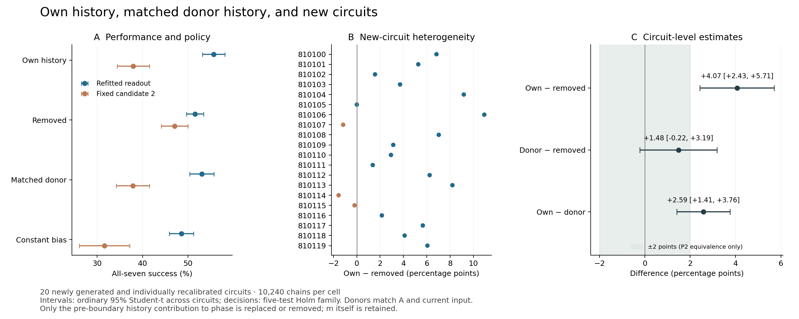

# 「間違った過去」と新回路一般化：取得・解析固定済み評価

2026-11-06。**外部事前登録ではなく、ローカルで取得前に計画と解析を固定した評価。**

## 主判定

新回路への正差の一般化を、この生成規則と較正手順の範囲で支持した。 P1の回路別差は正16回路・負3回路・ゼロ1回路だった。
P2は下表の5検定全体に対するHolm補正で判定した。通常の95%区間を補正済みの判定区間と読み替えない。

|主比較（再学習）|差 [通常95%区間]、ポイント|
|---|---:|
|P1：通常 − 除去|+4.072 [+2.433, +5.711]|
|P2：ドナー − 除去|+1.484 [-0.217, +3.186]|
|P2：通常 − ドナー|+2.588 [+1.413, +3.763]|

|凍結済み検定|生p|Holm補正p|判定|
|---|---:|---:|---|
|P1_B0_gt_B2|5.0924645e-05|0.00025462322|支持|
|P2_B0_gt_Bswap|0.00019064227|0.00076256908|支持|
|P2_equiv_swap_B2|0.26672626|0.80017877|未達|
|P2_equiv_swap_B0|0.84599119|1|未達|
|P2_Bswap_lt_B2|1|1|未達|

等価マージンは±2ポイント。等価性はTOSTのp値をHolm族に含めた。
「差を検出しなかった」を「等価」と判定していない。P1に先行評価の3ポイント基準を流用していない。
先行評価の下限2.98828125ポイントによる最小重要差基準未達は、そのまま未達として維持する。

凍結済み規則による解釈：

- P1 positive difference supported for this generator and recalibration procedure
- Own contribution outperformed matched donor contribution; same-state-content causality still not isolated

通常条件がドナー条件を上回るという登録済み比較は支持された。一方、ドナーと除去の比較では悪化も等価も支持されず、
Q1の「内容か動作点か」は完全には分離できなかった。これは全20回路の観測後に条件を選んだ追加検定ではない。

これは「知能の種」の同定でも、LIF/ALIFに対する優位の検証でもない。

## 取得内容と追跡可能性

- 訓練専用pilot：810000–810002。主評価には含めない。
- 主評価：810100–810119の20回路。元の乱数生成規則に加え、元の較正工程を各回路で再実行した。
- 回路ごとに訓練8履歴群、評価64履歴群、各群4行、保持512/16384。
- 4介入×2方策、各セル10,240チェーン、合計81,920チェーン。
- 再学習は条件別・同予算。副方策は各回路の較正済み第2候補に固定した。
- 推論単位は回路（n=20）。同一回路内のチェーンを独立標本として扱わない。
- ソース・計画の固定：`eb61938`、ハッシュ封印：`0862365`。
- 固定時刻（UTC）：`2026-11-06T06:21:38.954490+00:00`。1,330ファイルを封印してから主評価を開始した。
- 全回路を予定どおり取得。成績による回路差し替え・ドナー変更・追加取得なし。

旧pilot、先行の新cohort評価、既存E7-D確証は変更していない。
入力NPZの個別SHA256は生成直後・対応するシミュレーション前に保存した。
回路ごとの較正・学習済みモデルも評価cohort生成前にハッシュ固定している。

## 全7成功率

|条件|再学習読み出し|第2候補に固定|
|---|---:|---:|
|B0|55.635%|37.959%|
|B2_once|51.562%|47.061%|
|Bswap|53.047%|37.871%|
|Bconst|48.545%|31.621%|

各率は20回路の等重み平均であり、各回路の行数が等しいため行全体の平均とも一致する。
初回計算の後に続く7回がすべて正しい場合を成功とする。
定数条件Bconstは副次比較であり、過去成分の変動だけでなく減衰の時間形も変更する。

図の区間は回路単位の通常95% Student-t区間。緑の±2ポイント帯はP2等価性の尺度で、P1の閾値ではない。

## ドナー対照が変えたものと、残したもの

同一回路・保持・A・現在Bで異なる履歴群をペア化した。ドナーの境界状態は受け手と同じ現在入力振幅で再計算した。
位相、不応期、受け手の記憶mそのものは移植していない。位相計算に入る境界以前の成分のみを差し替えた。
評価の成否や状態の近さによる選定はしていない。適合ドナーなしによる除外は0件。

- 20回路×2保持＝40セルのドナー/自前標準偏差比：0.9928〜1.0079。
- 自前成分とドナー成分の相関：0.8952〜0.9878。
- 事前の分布診断境界を外れたセル：0/40。該当：なし。
- 読み出しの単一クラス等による固定候補fallback：なし。

同じAと現在入力を共有するため、課題記憶の内容全体を消した対照ではない。
周辺分布が近くても、残された位相等との適合性までは固定できない。
Bswap≈B0なら、この対応付けの範囲で個体固有の細かな履歴を置換できることまで。
「どんな過去でもよい」「動作点だけが原因」とは言えない。
Bswap≈B2も、一般的なバイアスで十分という証明にはならない。
また、hの差し引きはモデル内部の解析的な介入であり、実装可能な物理操作や無償の操作として評価したものではない。
20回路のStudent-t推論は近似であり、別の回路生成規則・課題・候補数への一般化は未検証である。

## 副次結果（主判定へ昇格させない）

- Bswap−Bconst：+4.502 [+2.537, +6.467]ポイント。
- 方策×B0/B2の交互作用：+13.174 [+9.877, +16.470]ポイント。
- 固定回路・学習済みモデルに条件づけたドナーペアblock bootstrap：+4.072 [+3.350, +4.795]ポイント。

上のbootstrapは回路一般化の検定ではない。同じドナーペアを両保持時間でまとめて再標本化した。

固定準備では通常37.959%に対して除去47.061%となり、再学習と固定準備の逆転を新回路でも観測した。
一方、保持512での差+5.430ポイントは保持16384での+2.715ポイントより大きく、先行5回路評価とは大小関係が逆だった。
「長く保持するほど寄与が増える」という一般化は支持しない。A=0の差−0.430ポイントは区間が0を含み、
A別の厳密な符号反転も今回のデータから確立したとは書かない。

|比較・条件|差 [通常95%区間]、ポイント|
|---|---:|
|B0_minus_B2 / A0|-0.430 [-2.659, +1.800]|
|B0_minus_B2 / A1|+8.574 [+5.826, +11.323]|
|B0_minus_B2 / hold512|+5.430 [+2.650, +8.209]|
|B0_minus_B2 / hold16384|+2.715 [+1.456, +3.974]|
|B0_minus_B2 / next1|-0.020 [-2.981, +2.942]|
|swap_minus_B2 / A0|-2.246 [-4.779, +0.287]|
|swap_minus_B2 / A1|+5.215 [+3.238, +7.192]|
|swap_minus_B2 / hold512|+1.211 [-1.427, +3.849]|
|swap_minus_B2 / hold16384|+1.758 [+0.503, +3.013]|
|swap_minus_B2 / next1|-1.484 [-5.118, +2.149]|
|B0_minus_swap / A0|+1.816 [+0.765, +2.868]|
|B0_minus_swap / A1|+3.359 [+1.531, +5.188]|
|B0_minus_swap / hold512|+4.219 [+2.382, +6.055]|
|B0_minus_swap / hold16384|+0.957 [+0.041, +1.873]|
|B0_minus_swap / next1|+1.465 [+0.461, +2.469]|

失敗分解は、実際の次入力についての候補不足、候補がある場合の選択失敗、4プローブ共同準備の選択失敗を区別した。
表ではそれぞれの分母を明示する。異なる方策は異なる状態へ進むため、方策間の失敗構成を同じ状態での因果分解と呼ばない。

|条件/方策|実入力で候補なし / 全判断|実入力の選択失敗 / 候補あり|共同準備の選択失敗 / 共同候補あり|
|---|---:|---:|---:|
|B0/refit|4439/71680|3997/67241|2041/56483|
|B0/fixed|4611/71680|8914/67069|12673/56440|
|B2_once/refit|3996/71680|6295/67684|6450/57140|
|B2_once/fixed|4350/71680|7102/67330|8028/56129|
|Bswap/refit|4253/71680|5189/67427|3999/56368|
|Bswap/fixed|4611/71680|9025/67069|12669/56573|
|Bconst/refit|4230/71680|6335/67450|5083/54870|
|Bconst/fixed|4632/71680|9923/67048|13340/55009|

## 回路別の主比較

|回路|B0−B2|Bswap−B2|B0−Bswap|
|---|---:|---:|---:|
|810100|+6.836|+1.367|+5.469|
|810101|+5.273|+0.586|+4.688|
|810102|+1.562|+0.391|+1.172|
|810103|+3.711|+4.102|-0.391|
|810104|+9.180|+5.078|+4.102|
|810105|+0.000|+0.391|-0.391|
|810106|+10.938|+10.156|+0.781|
|810107|-1.172|-3.320|+2.148|
|810108|+7.031|+0.586|+6.445|
|810109|+3.125|-0.195|+3.320|
|810110|+2.930|+2.734|+0.195|
|810111|+1.367|+0.977|+0.391|
|810112|+6.250|-1.758|+8.008|
|810113|+8.203|+5.469|+2.734|
|810114|-1.562|-6.250|+4.688|
|810115|-0.195|-2.734|+2.539|
|810116|+2.148|+2.344|-0.195|
|810117|+5.664|+5.664|+0.000|
|810118|+4.102|+2.930|+1.172|
|810119|+6.055|+1.172|+4.883|

## 監査・データ・再現手順

- 保存データ監査：320ファイル、合格。R発火数とA/Bからの別採点、候補予測、介入前共通状態、成分方程式、有限値、shadow、SHAを確認。
- 別実装scalar監査：192軌道＋自前/ドナー境界128件、合格。最大絶対誤差0。
- 同じ作業内の別実装検査であり、外部研究者による独立追試ではない。
- 過去の利用可能な2レール位相21,404組＋新pilot888組を予約し、新cohortとの重複を検査した。
  非対応形状30記録と未取得のリモート履歴は保証範囲外。利用可能な追跡テキスト4,027ファイルで新ID/派生seedの完全整数リテラル一致も検査した。
- `chains.csv.gz`：81,920行。`decisions.csv.gz`：573,440行。`circuit_results.csv`：20回路。
- 元のNPZには状態、特徴、全候補評価、入力、ドナー対応表、各ファイルの個別ハッシュを保存。
- `costs.json`は4並列での各worker経過時間。CPU時間やハードウェア効率の証拠として扱わない。

再現手順：[実験README](../../../experiments/wrong_history_generalization/README.md)。
図はPNG/SVG/PDFを保存した。`analysis.json`は凍結した解析の機械可読結果であり、表示用スクリプトで判定を書き換えていない。
